# Bitcoin mixer-service classification

Five-class classification of Bitcoin transactions using input/output topology, output-value distributions, script types and fee characteristics. The original study used asynchronous feature acquisition, class-weighted XGBoost and SHAP.

**Author:** Paul Trassaert. This portfolio version contains provider-independent feature extraction and a stricter train/development/test evaluation workflow. The extraction refactor and audit were prepared with AI assistance. Private API connectors, interview instructions, reference documentation and datasets are not distributed.

## Task and historical results

Classes: `Bitcoin Fog`, `JoinMarket`, `SamouraiWallet.com`, `WasabiWallet.io`, `other`. These are service-attribution labels; they do not establish illegality or fraud.

The original feature extraction covered 32,682 training, 16,176 labelled test and 16,392 unlabelled validation transactions. The training distribution was imbalanced (approximately 85.2% `other`). Saved baseline five-fold stratified CV macro-F1 was **0.8903 ± 0.0041**.

The later notebook reported **macro-F1 approximately 0.95** and mean one-vs-rest ROC-AUC **0.9981** on 6,537 examples drawn from the training file. **That same internal holdout was used for early stopping**, and the notebook describes iterative experimentation. These are model-selection diagnostics, not an untouched test result. Although `final_test` was extracted, it was never evaluated by the supplied notebook. The raw feature files are unavailable in this repository, so those reported scores have not been independently reproduced.

## Original figures and analysis

Read [the complete original analysis](docs/original-analysis.md) for the development choices, interpretations and conclusions, with all saved charts in notebook order. The captions below refer to the original experiment; current methodological qualifications are recorded in [AUDIT.md](AUDIT.md).

### Transaction patterns

The study compares class imbalance, transaction topology, output-value entropy and script-related features. The majority class represents about 85.2% of the training set, motivating macro-F1 and per-class diagnostics. The original “Market Share” label is a dataset proportion, not a market estimate.

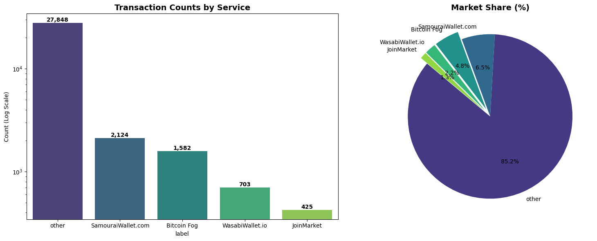

*Class distribution — original saved notebook output.*

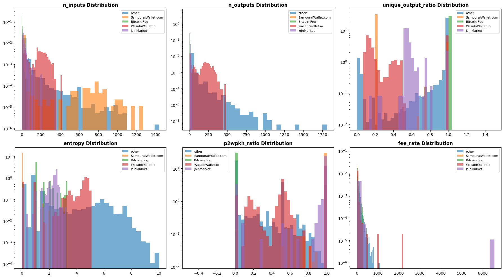

*Feature distributions — original saved notebook output.*

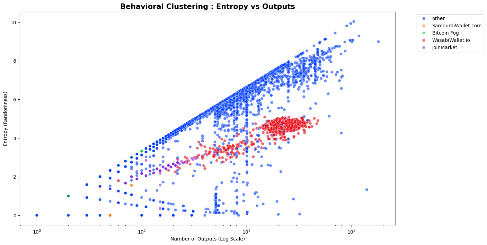

*Entropy versus output count — original saved notebook output.*

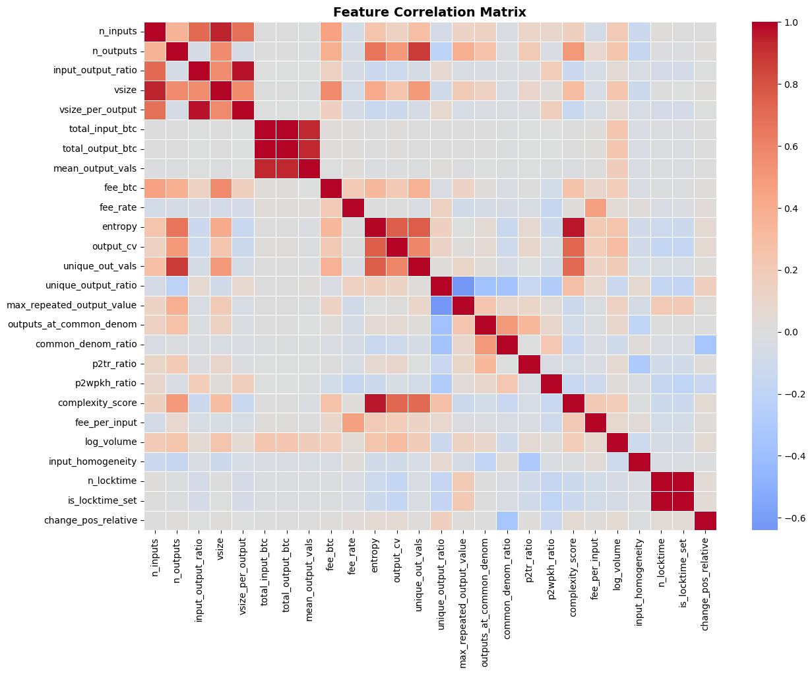

*Feature correlations — original saved notebook output.*

### Classification diagnostics

The confusion matrix and ROC curves come from the internal development holdout used for early stopping. They show where classes overlap, especially Wasabi versus other, but do not measure performance on an untouched test set.

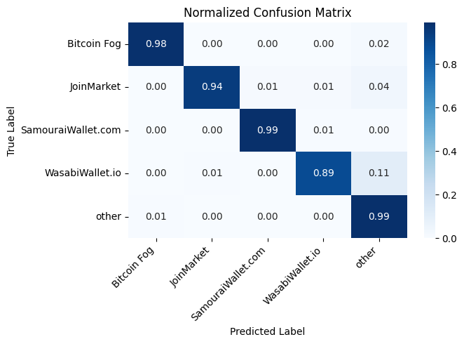

*Normalised confusion matrix — original saved notebook output.*

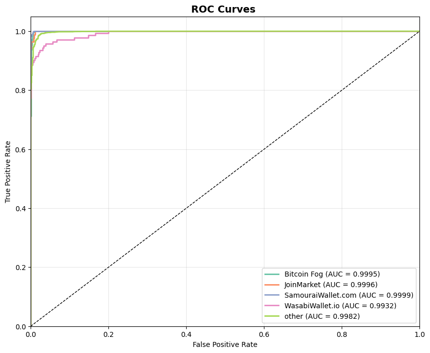

*One-vs-rest ROC curves — original saved notebook output.*

### Model explanations

Global and class-specific SHAP plots describe feature contributions to model outputs. They help explain learned patterns; they do not prove why a service implemented a protocol or identify illegal activity.

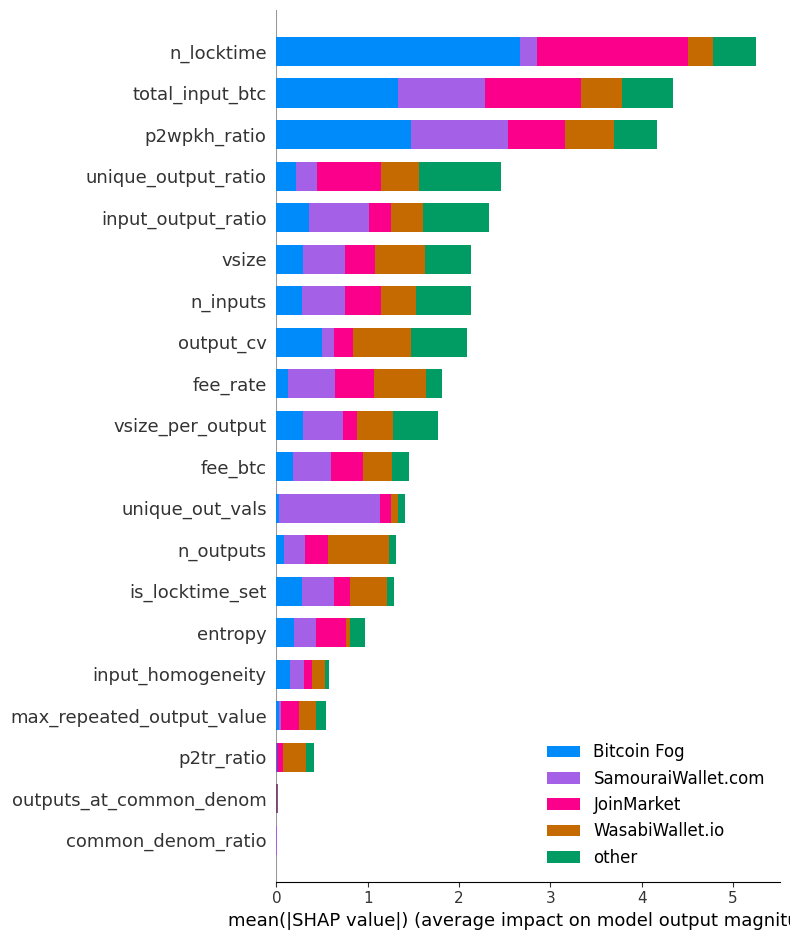

*Global SHAP importance — original saved notebook output.*

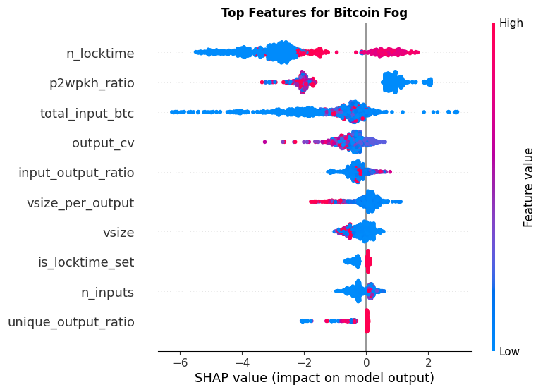

*SHAP: Bitcoin Fog — original saved notebook output.*

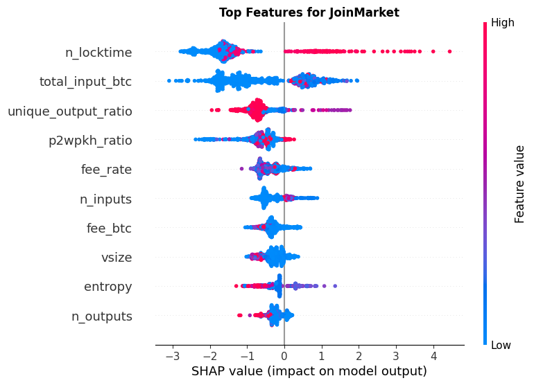

*SHAP: JoinMarket — original saved notebook output.*

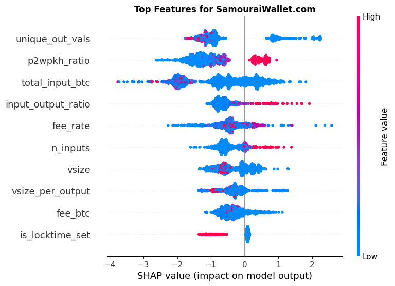

*SHAP: SamouraiWallet.com — original saved notebook output.*

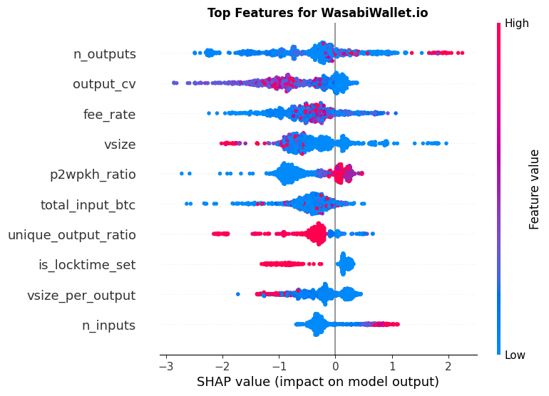

*SHAP: WasabiWallet.io — original saved notebook output.*

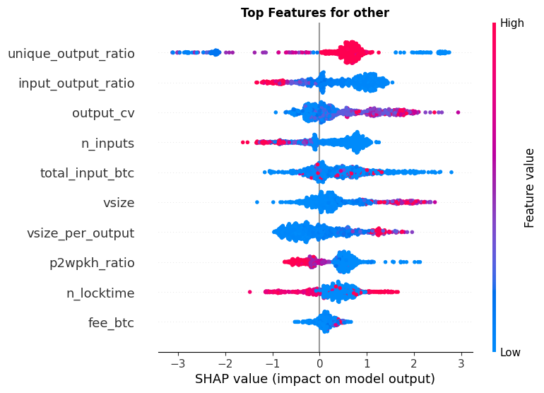

*SHAP: other — original saved notebook output.*

## Run

Python 3.11+:

```bash
python -m venv .venv
source .venv/bin/activate
python -m pip install -r requirements.txt
python -m unittest -v
python train.py --train-features data/train_features.csv --test-features data/test_features.csv --out results/run
```

Provide your authorised, locally exported feature tables. Both files require unique `txid`, one of the five labels in `label`, and matching numeric feature columns. Metadata and redundant columns listed in `EXCLUDED` are removed explicitly. The command rejects cross-split transaction overlap, schema mismatches and non-finite features. Exact transaction separation does **not** establish graph/entity/temporal independence; those checks require additional provenance.

The default is a fixed Random Forest reference. For XGBoost, install the optional dependency and select it:

```bash
python -m pip install -r requirements-xgboost.txt
python train.py --model xgboost --train-features data/train_features.csv --test-features data/test_features.csv --out results/xgb_run
```

The script splits the training file into fit/development sets. Only development labels can affect early stopping. The provided test file is evaluated after fitting. Do not tune the model after inspecting the reported test metrics and continue calling that file untouched. The random internal split is a convenience baseline; future entity-aware or chronological validation should follow the actual deployment question.

## Feature extraction

`features.transaction_features(record)` accepts a local dictionary with:

```python
record = {
    'txid': 'example',
    'input_values_sats': [401000],
    'output_values_sats': [100000, 100000, 100000, 100000],
    'input_scripts': ['P2WPKH'],
    'output_scripts': ['P2WPKH'] * 4,
    'vsize': 200,
    'locktime': 0,
}
```

All amounts use integer satoshis. Non-coinbase inputs, positive size, matching script/value lengths and non-negative fees are validated. Entropy describes frequencies of output amounts, not monetary shares.

The old `change_pos_relative` mixed a missing sentinel with the number of outputs. The revised proxy uses a consistent −1 for absence and a separate indicator. It is named `first_nondenom_relative_position`: a non-standard denomination is **not proof of a change output**. `max_equal_output_count` explicitly denotes a count, not a Bitcoin amount. Because some feature definitions changed, old trained models must not be loaded against this schema without retraining.

## Repository contents

- `features.py`: local, provider-independent feature extraction.
- `train.py`: separate development/test evaluation; Random Forest and optional XGBoost.
- `test_features.py`: amount, sentinel and cross-split integrity checks.
- `notebooks/portfolio_walkthrough.ipynb`: feature demonstration and evaluation instructions.
- `archive/original_model_analysis.ipynb`: original student modelling cells with outputs stripped, supplied as historical context. Requires original exported feature tables and optional plotting/SHAP packages; it is not the supported reproduction path.
- `AUDIT.md`: provenance and evaluation limitations.

Real training/test data was not supplied, so only feature/split tests and a clearly synthetic Random Forest execution check could be run during this packaging. The XGBoost path was not executed in this environment. No new real-data performance score is claimed.

No licence is applied to third-party data or interview materials. No proprietary material is included in the supported implementation.
